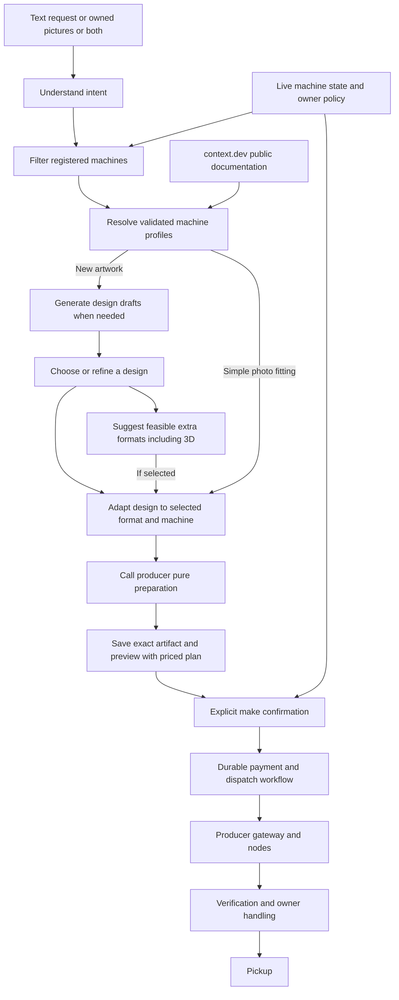

# Fabyn consumer orchestration from request to finished jobs

**Design · October 24, 2026 · Implemented and tested in simulation (see [implementation status](#implementation-status-october-24-2026)) · Original baseline: `3a03a90`**

Fabyn should turn pictures, a short request, or both into a concrete, priced production plan. A person can upload a photo or simply say “I want a cat sticker.” The agent generates design drafts when needed, lets the person pick a favorite, and adapts it for suitable registered machines using their validated documentation. It can also suggest useful ways to make the chosen design, including supported 3D items. The requester chooses the design and approves the result and total; the app handles production.

The normal experience is **add photos or describe an idea → choose a draft when needed → review the prepared result and price → confirm → collect**. Suggested formats and edits remain optional. Machine selection, documentation retrieval, production settings, file conversion, scheduling and recovery belong to the app.

This document specifies the consumer orchestration work and its interfaces to UI, producer and payment components. It incorporates the [shared Claude build design](https://claude.ai/artifact/XCDCcTZ2uSeRnRRYSHj4mT#7514c53b-626e), especially its item/assignment/job model and gift and relief scenarios. It describes proposed behavior, not completed implementation or hardware acceptance. Existing contracts remain in force until their replacements are implemented and reviewed.

The settled architecture is **consumer-owned creative design and orchestration, producer-owned pure production preparation, and mixed real/simulated Relief in P0**. Producer preparation returns the exact file and preview before the consumer makes an offer. Relief uses immutable per-assignment execution modes throughout the same workflow; simulation is labeled and financially separate. The detailed contracts, ownership, states, APIs/events, pricing, cancellation, examples and acceptance criteria below form one complete plan.

## Implementation status (October 24, 2026)

This plan is implemented end to end **in simulation with mock payments**. No hardware was operated, no live Claude call was made, no funds moved, and context.dev was called once (one page, at profile-build time). Sections 1–13 below remain the specification; this section records what exists and where it differs.

| Part | Where | State |
| --- | --- | --- |
| Orders, drafts, plans, offers, make intents, events | [orchestrator](../server/orchestration/orchestrator.ts), [types](../server/orchestration/types.ts), [routes](../server/orchestration/routes.ts) | Implemented: text, photos or both; Claude or fixture drafts (3 per round, at most 3 rounds, **More like this**); one confirmation saving a MakeIntent; idempotent replay; cancellation of work that has not started |
| Intent | [intent](../server/orchestration/intent.ts), [Claude parsers](../integrations/src/claude.ts) | Claude when configured, otherwise a labeled local reading that never invents names; gifts use editable **FOR YOU** text |
| Machine knowledge | [knowledge](../server/orchestration/knowledge.ts), [context.dev wrapper](../server/orchestration/context-dev.ts), `npm run profile:build` | Published profiles for the three team models with a basis per field; hardware refuses critical fields that are only assumptions. The builder reads at most two public pages at onboarding time only, keeps a value only when its quote is on the page and the field applies to the process. One live call read the official M02 Pro page and confirmed 300 DPI with no conflict |
| Eligibility and pricing | [matching](../server/orchestration/matching.ts), [pricing](../server/orchestration/pricing.ts) | Intended result before price (a colour photo never goes to the thermal printer); `price-card-v1` in integer cents with a 10% fee rounded half up |
| Producer preparation | [`fabyn-producer`](../node/fabyn_node/producer.py), [contract](node-integration.md#production-preparation-fabyn-producer) | Pure CLI: canonical design in; exact artifact, preview, hashes and estimates out. Sticker 1-bit PNG at 300 dpi, Instax 600×800, simulation-only text-tag 3MF, simulated catalog items |
| Per-assignment modes and children | [service](../server/service.ts) | Each child job carries its own immutable mode; simulated children are estimate-only, never charged and end without a pickup code; evidence must match the mode |
| Relief | [relief](../server/relief/), historical coordinator page (removed) | Team machines first, then a seeded 150-machine simulated network (min-heap split, time-scaled engine); outage or new-machine replanning moves only never-started simulated work, within 125% of the simulated estimate |
| Requester and coordinator pages | `/fabyn/order` (formerly `/make`); the legacy `/relief` page has been removed | Request, drafts, exact preview, extras, one confirm, progress; relief plan, confirm, outage, restore, add machine, time scale |

Differences from the specification:

- **Bundle payment on testnet** is not implemented: a payable plan in testnet mode is refused with `BUNDLE_PAYMENT_UNSUPPORTED` before anything is reserved. Mock bundle payment, allocation funding and release on failure are implemented.
- **3D slicing belongs to the receiving end.** Our end hands over the exact unsliced 3MF (marked `slicing: "receiver"`) with its size, material and estimates; the receiving end slices it for the printer. The A1 mini's 180×180×180 mm build volume is documented from Bambu's official spec table. Relief still never assigns tarp clips to the team's printer because no vetted model exists.
- **Owner time limit**: a prepared 3D estimate longer than the machine's per-job limit is explained before any offer instead of failing at dispatch (a FOR YOU tag is about 16 minutes; the node's default limit is 15).
- **Producer outputs become owner-scoped assets**: identical bytes for two people are two private assets, so one person's draft or preview is never readable by another.
- Order events are polled from saved state (`GET /api/orders/:id`, `/events?after=`) and nudged by the existing server-sent refresh; there is no per-order event stream.

## 1. Product decisions

1. **Start with pictures or words.** Put a short request input alongside **Add photos**. Accept photos alone, text alone, or both; require neither a machine picker nor production settings. Uploaded photos can start preparation automatically; submitting text starts the request, rather than generating on every keystroke. Show an editable default or a small set of design drafts; ask one outcome question only when essential.
2. **Show one coherent plan.** A request normally proposes one suitable item. A clearly labeled gift entry point can propose a three-piece bundle: photo, sticker and prepared keychain. The requester approves the whole visible bundle and total. Optional format suggestions must not silently turn a single-item request into a charged bundle.
3. **Choose for the intended result before price.** Preserving a color photograph, a readable label or an important subject is an eligibility requirement. A cheaper machine that cannot achieve the intended result is excluded.
4. **Prepare before asking for approval.** Show the actual adapted output, quantity, physical format, material/color limits, ready estimate, collection point and full price together. Keep machine identity, reasons and detailed price terms under secondary details. The gift plan can have three item previews without three separate checkout flows.
5. **One final make action.** Target an explicit rights confirmation plus **Pay $X & make**, with any required wallet interaction. The backend must durably record consent to both payment and production. This requires new orchestration support; combining today's buttons in frontend code is insufficient.
6. **Keep physical work honest.** Owners still load media, inspect uncertain results, clear outputs and confirm pickup readiness. Simulation, local analysis, mock payment and testnet labels remain visible where the person makes a decision.
7. **Offer useful possibilities.** After a design is chosen, suggest a few feasible extensions, such as a matching cat keychain or a photo print. Keep the requested item primary. Suggestions are optional and use the registered machine/template capabilities; the person need not browse machines or know what else can be made.
8. **Prepare through the producer; support mixed Relief in P0.** Consumer orchestration submits a canonical design to the producer's pure preparation interface and presents its returned production preview for requester approval. A Relief plan combines the team's supported real machines with simulated machines; every assignment declares what physically runs, what is simulated and what is payable.

For photo-only gifts, propose editable neutral keychain text such as “FOR YOU” rather than guessing a person's name from their face. Enforce the shared design's ten-character limit and the supported template's actual character set. A keychain template or vetted catalog model is a separate asset path; a photograph does not become a production-ready 3D model automatically.

## 2. The requester experience

| State | What the person sees | What Fabyn does |
| --- | --- | --- |
| Request | One short request field with **Add photos** beside it; either input works alone | Validates text and any owned images, starts a versioned draft |
| Designing | A stable preview area; “Designing your cat sticker…” or “Preparing your photo…” | Understands intent, checks feasible machine formats and resolves profiles; generates drafts when new artwork is needed |
| Choose a design, when needed | Up to three progressively arriving drafts, **Use this design** and **More like this** | A validated draft is immediately selectable; saves the choice and calls producer preparation without waiting for other drafts; ordinary photo fitting skips this step |
| Proposal | Producer's actual production preview, payable total, collection and ready estimate; optional “Also make this as…” suggestions | Saves an immutable plan/offer; identifies each Relief part as real or simulated and shows simulated network estimates separately |
| Confirm | Artwork permission, clear payment-mode label, **Pay $X & make** | Revalidates the plan, records make authorization, collects payment and submits jobs through a recoverable workflow |
| Progress | “Preparing”, “Making”, “Checking”, “Ready for pickup”; one action when needed | Reconciles production, verification, payment and owner handling independently; simulated progress never implies physical supplies or pickup readiness |
| Collect | Pickup code and finished-item photo; per-item readiness for a bundle | Redeems the saved collection credential and records handoff |

An unavailable machine should not send the requester into setup. Preserve the request, pictures and chosen design and explain the limitation, for example, “No available machine can preserve these colors right now.” Offer a deliberate recheck or a clearly described alternative. Missing documentation is a provider/internal issue. A lost payment or start response says “Checking your existing order” and recovers the saved operation; it must not invite another payment or another print.

The design picker records taste, not production consent. Selecting a draft never pays, starts a machine or approves a later machine-specific conversion. Editing the request, photo, design, crop or quantity starts a new draft version; only the final production proposal becomes confirmable. Do not force ordinary photo uploads through a design gallery. Announce progress accessibly without repeatedly moving keyboard focus. Keep actions usable at 320px with visible focus and stable layout. The current [minimal interface design](ui-redesign.md) provides the visual hierarchy; the request field and draft choices extend it.

## 3. Ownership and architecture

Use one durable orchestrator with bounded steps and typed inputs/outputs. Claude interprets intent and proposes design choices; deterministic code validates capabilities, selects assignments, calculates amounts and authorizes transitions. A language model never receives a generic execute-command, pay or start-machine tool.

| Owner | Owns | Handoff |
| --- | --- | --- |
| Consumer orchestration | Intent planning, knowledge profiles, canonical design candidates/selection, feasible format suggestions, matching, preparation calls, pricing, plan versions, replanning, make intents and consumer APIs/events | Sends owned canonical designs for preparation, then approved preparation receipts and child jobs for execution |
| Producer | Device-correct compilation and preflight through a pure preparation interface, gateway transport, manifests/live status, adapters, execution journal, progress, completion and handling requirements | Returns immutable production artifacts/previews and estimates before offers; reports readiness and execution outcomes separately |
| UI | Upload, editable plan, consent, payment interaction, progress and actionable recovery | Renders saved server state and sends version-bound actions |
| Payment component | Collection, reconciliation, ledger allocations, release/refund and transaction receipts | Reports confirmed/pending/failed outcomes for a saved payment operation |

The shared artifact describes a FastAPI `hub/`; the current repository uses an Express server. The plan and job contracts below are framework-independent. Implement them as modules/adapters over the current app first, or port them after an explicit team architecture decision. This design does not authorize or require a backend rewrite. Likewise, the proposed `/ws/node` protocol is a producer-owned transport boundary, not a reason for the consumer to replace the existing outbound connector.

## 4. What exists and what is missing

| Area | Current repository | Required change |
| --- | --- | --- |
| Intake | Authenticated owned image uploads, hashes, decoding limits; optional note; structured Claude analysis and labeled local fallback | Accept text-only requests as well as photos; persist complete preparation drafts and stage results |
| Matching | Saved capability/readiness filtering, then lowest price and stable machine ID | Quality/intent eligibility, validated profiles, deterministic scheduling and multi-item assignments |
| Documentation | No context.dev client or evidence-backed print profile | Server-side retrieval, validation, versioned profile store and provider repair path |
| Image preparation | Deterministic orientation, composition, sizing, crop and thermal dithering | Consumer-owned canonical designs and selection; producer-owned pure compiler/preflight with saved results; feasible alternative formats |
| Approval | Exact artifact/specification/machine approval and atomic approval-plus-quote | A proposal offer before approval, then one durable make authorization |
| Execution | Persisted payment/job state, exact-machine dispatch, attempt IDs and node reconciliation; a global execution mode | Parent plans, billable child allocations, immutable per-assignment modes and recoverable mixed-mode submission |

Implementation anchors: [recommendations](../server/recommendations.ts), [HTTP routes](../server/app.ts), [job service](../server/service.ts), [model](../server/model.ts), [image preparation](../node/fabyn_node/prepare.py) and [node integration](node-integration.md). Keep their existing ownership, consent and unknown-outcome protections.

One important integration trap: `POST /api/jobs` currently prepares the original uploaded pictures again. A separately generated design would be discarded if its draft were sent through that path unchanged. Add a server-owned **create from saved design draft** path that loads the producer's saved preparation receipt/final artifact and uses the existing `createWithResult` service seam. Never trust a browser-supplied artifact hash or silently rebuild from the originals after approval.

## 5. Preparation pipeline

### A. Save and understand the request

Accept zero to four photos plus a bounded text request, requiring at least one photo or nonblank trimmed text. “I want a cat sticker” is a complete request without an upload. This extends the current image-required intake validation. Save the request and any source asset IDs, ownership and content hashes before analysis. Decode and normalize uploaded images under the existing format/resource limits. Keep originals private and create normalized working copies without unnecessary metadata. Treat request content as user data, not instructions that can override the orchestration contract.

The planner returns a schema-validated `IntentBrief`: requested outcome/process when specified, creation kind (preserve, generate or combine), source-to-item mapping, important subjects/text, color requirements, permitted transformations, quantity and any essential unresolved choice. An explicit request for a sticker guides the result; the person does not choose a machine. It proposes items only from enabled process/template capabilities and cannot invent machines, media, dimensions or prices. Structured JSON still needs semantic validation.

Photo-only default: preserve recognizable subjects, existing text and color when important; compose multiple pictures into one clearly previewed item unless the visible entry point requests a bundle. Background removal, stylization and invented captions should not silently change the meaning of the uploaded artwork. Optional edits create a new proposal. Artwork permission remains explicit; a detected logo alone neither proves infringement nor proves authorization. Follow the current owner's content policy and review path rather than adopting the artifact's blanket logo ban.

For text-only or creative requests, generate up to three distinct draft images within the feasible output's constraints. Save candidate IDs and hashes under the requester's ownership, with prompt/model/version lineage and a recommended default. Publish each validated candidate progressively in a stable position; the person can choose immediately and later results cannot reset that choice. A draft is a design concept, not the final production file or a guaranteed quote. **Use this design** saves a version-bound creative preference, then invokes producer preparation for the exact preview and price. Permission wording covers supplied references and making the selected design, rather than claiming the person authored every generated image.

### B. Filter and select machines

Start from the registered database. Exclude unsupported processes/adapters, wrong execution mode, incompatible media/color/size, insufficient material, unmet owner policy, unavailable connections, uncleared machines and work that cannot fit the allowed duration/hours. Unknown critical capability values fail eligibility rather than becoming model guesses.

For the current interactive flow, require the existing ready/idle/reservation checks. Future queue scheduling needs a producer contract for queue capacity and finish estimates; do not present a busy current node as accepting queued work merely because the new matcher can calculate a queue.

Resolve validated profiles for a small shortlist, then rank eligible candidates in this order:

1. Meets the intended output and passes design-quality thresholds.
2. Meets a stated deadline and supported collection location; otherwise earliest realistic finish.
3. Lower total price among equivalent results and finish choices.
4. Stable machine ID as final tie-breaker.

Use named rubric results such as `color_preserved`, `text_readable` and `subject_fits`, not an uncalibrated model confidence presented as a probability. Record rejected candidates and reasons privately. Freeze the machine-state snapshot, policy version and tie-break rules so a fixture/seed can replay the same selection. Reread live state before an offer and again before confirmation/dispatch.

### C. Design and call producer preparation

The consumer creates a `DesignBrief` and canonical design for each item/selected profile: request and selected candidate lineage, source hashes when present, target process, printable region, orientation, safe margins, color mode, composition, critical content and allowed transformations. It composes ordinary photos/labels or uses a design provider for new artwork such as a text-only cat sticker. context.dev supplies machine documentation, not the renderer. After selection, the canonical design is immutable input to producer preparation; a generative redraw requires a new visible design choice.

The **producer owns the only device-correct compiler and preflight implementation**. The consumer calls `producer.prepare` before calculating the final price or showing an offer. Pure preparation reads authorized design inputs and pinned profiles and may write immutable derived files/result caches; it does not contact or operate physical devices, start/stop jobs, reserve media or collect payment. Readiness is checked separately. Deployment may place this compiler beside the hub or node, but ownership and the contract stay with the producer.

Preparation validates decoded type, raster dimensions, physical units, margins, color/bit depth, file limits, quantity and adapter compatibility. It returns the final production artifact and corresponding preview, validated parameters and material/time inputs. Important text/subjects must remain visible; empty, corrupted or unreadable results fail preflight. Permit one bounded repair attempt before an offer; a material change to the chosen design returns to explicit design choice rather than silently substituting artwork.

| Pure preparation contract | Required content |
| --- | --- |
| Request | Stable preparation/idempotency key; owned canonical design/source references and hashes; exact machine/process; immutable `executionMode`; pinned profile/adapter versions; proposed dimensions, material, quantity and allowed transformations |
| Ready result | Preparation ID/input digest; canonical design hash; machine/mode; profile/compiler versions; immutable executable artifact for hardware, or a simulation recipe reference/hash with executable artifact absent; corresponding preview reference/hash and type/dimensions/color metadata; canonical validated parameters; material/time estimates with units and measured/slicer/estimated/simulated basis; warnings and handling requirements |
| Rejection | Typed failure or needs-review reason; no invented ready artifact or quote. Replaying a preparation key returns the saved result for identical inputs; different input requires a new key/version |

Persist this receipt before pricing. The offer/approval binds its ID, production hash, profile/compiler versions, execution mode and validated parameters. The later execution call consumes that saved result without recompilation; a missing artifact or incompatible current profile requires reconciliation/new preparation and proposal, not regeneration after payment.

| Process | Consumer preparation | Approval and producer boundary |
| --- | --- | --- |
| Thermal sticker | Compose canonical high-contrast artwork and preserve important lines/text | Producer fits to the validated loaded-roll profile and compiles/dithers before the offer. Show that exact raster; execution only packs the approved pixels into the device protocol |
| Instax photo | Preserve color/subjects and specify the allowed composition | Producer fits to the verified image window/orientation/raster before the offer. Separate outside film dimensions, printable area and raster; never use a 4×6 postcard assumption for the Mini Link 3 |
| Prepared 3D | Select a vetted model or supported bounded text template | Producer performs trusted slicing/preflight before the offer and returns the exact executable artifact, corresponding preview and statistics. Current photo intake cannot generate arbitrary 3D |
| Simulated catalog processes | Select the fixed catalog's item and preview | Producer's simulation preparation returns labeled catalog estimates and no claimed physical production file. The simulation job consumes that immutable simulated result |

Current code assumes 300 DPI for thermal sizing and uses a 600×800 Instax raster with 54×86 mm outside film dimensions. These are **software assumptions to reconcile with the actual adapter and authoritative documentation**, not newly verified machine specifications. A document field must distinguish `media_outer_mm`, `printable_area_mm`, `raster_px` and `dpi`; none may be inferred from another when the relationship is unknown.

Scaling, dithering, cropping and slicing belong to producer preparation **before** the offer. After approval, execution allows only documented protocol packaging that preserves the approved output. No later crop, re-dither, semantic regeneration, re-slice or profile change is allowed without a new preparation receipt, preview and approval. There is no separate consumer production compiler or alternative post-payment preparation path.

### D. Persist a proposal

Save each item, assignment, producer preparation receipt, price inputs and actual preview as one immutable plan version. An offer binds that version to its artifacts, machines, material, execution/payment modes, payable amount, separately labeled simulated estimates, collection point and expiry. Generate the price only after producer preparation inputs are available. Offer preparation is not artwork approval, payment or machine-start permission.

After design selection, surface at most two relevant **Also make this as…** options that registered machines and supported pipelines can actually produce, each with its preview, incremental price and readiness impact. Distinguish **Use this format instead** from **Add another item**, and let the person remove an added optional item before confirmation. Ignoring suggestions leaves the requested item ready to continue. Selecting an option calls producer preparation and creates a revised proposal with updated previews and total; it never silently switches the design or adds a paid job. The fixed three-item gift contract cannot receive a fourth item until its versioned extension is agreed; initial add-on suggestions apply to the single-item experience. A 3D option requires a real model/template and supported geometry/preflight pipeline—for example, a catalog cat keychain when one exists. A flat cat image alone is not executable 3D geometry. Arbitrary generated 3D stays a future capability until its pipeline is supported.

### E. Example: one color portrait, no note

The requester uploads a color portrait. The planner records that recognizable subjects and color should be preserved. The matcher excludes the cheaper thermal machine because it cannot preserve that result, selects an eligible registered photo machine, and resolves its exact model/media profile from the knowledge cache. The consumer preserves the canonical photo/composition and calls producer preparation. The producer fits it to the verified image window and returns the final adapter-compatible artifact, actual preview and estimates. The consumer saves that receipt, computes the price and shows one make action. After confirmation, the coordinator funds and dispatches that exact prepared artifact through one child job. No step asks the requester to choose a printer, find a manual, enter DPI or export a file. If the photo machine is unavailable, the app keeps the pictures and explains the limitation rather than silently offering monochrome.

### F. Example: “I want a cat sticker”

No photo is required. The consumer agent checks the available sticker capability and produces three suitable cat drafts, such as a simple outline, a curled-up cat and a playful face. The person picks one or requests a small edit. The consumer sends the selected canonical design to producer preparation, then displays its exact monochrome preview and price. It can also offer a supported cat keychain format. The person can continue with only the sticker, replace the format or explicitly add the keychain. A selected 3D option goes through producer model preparation/slicing and gets its own exact model/production preview and price before the final make confirmation. The agent handles machine selection and all preparation handoffs.

## 6. context.dev and the machine knowledge layer

context.dev provides web search and page extraction. Use its documented search/scrape interfaces server-side; API credentials stay in an ignored environment file. The [search API](https://docs.context.dev/search/overview) finds candidate pages; known authoritative URLs should go directly to scraping. Domain filters can restrict discovery to the manufacturer's official documentation. ([Filters](https://docs.context.dev/search/filters))

**Resolve documentation when a provider onboards or updates a supported model, then reuse published profiles during requests.** Prepare the supported real-machine profiles and sourced assumptions for the seven simulated-only processes before the demo. Reading a published profile satisfies the orchestration's machine-knowledge step; no order waits on external documentation retrieval. Unknown models do not become supported by finding a manual; adapter support and calibration remain producer responsibilities.

Retrieval flow:

1. Resolve the exact manufacturer/model and approved adapter version from the registry, not image-analysis guesses about nearby models.
2. Orders read an existing usable published profile. If required facts are missing, contradicted or revoked, exclude that machine and queue an internal/provider repair task while preserving the request/design. Refresh in the background; do not fall back to guessed values or fetch documentation during checkout.
3. During build/onboarding/repair authoring, fetch known official manual/specification URLs first, otherwise search the exact model within official domains. Initial budget: inspect at most two authoritative pages per model and two concurrent fetches. These are proposed app limits, not vendor service guarantees.
4. Extract only relevant facts into nullable, unit-explicit fields, retaining the source page/section and evidence text for every critical fact. context.dev's JSON extraction supports schemas, but missing required values can receive best-effort guesses. Use optional/nullable fields and verify evidence; a valid schema is not proof. ([JSON extraction](https://docs.context.dev/scrape/json))
5. Compare against the adapter contract, owner configuration and other sources. Conflicting model names, units, printable regions or color modes create `needs_review`. Never average conflicting numbers or accept the more permissive value.
6. Publish an immutable validated profile only when required fields are supported. Pin its version in every draft/offer/job. A critical correction revokes affected unconfirmed offers; accepted physical jobs require reconciliation, not automatic regeneration.

`MachineKnowledgeProfile` records exact model, adapter/firmware compatibility, media, process, printable region, accepted raster/format/color limits, safe margins, source URLs/titles, retrieval times, content hashes, evidence per field, validator version and publication/revocation status. Distinguish documented facts, tested adapter requirements and owner limits. Store larger source snapshots in private immutable asset storage; keep references and bounded structured metadata in the application store.

Effective capability is the **intersection of the tested adapter contract, validated documented bounds and current owner policy/media**. Documentation may narrow eligibility; it cannot grant device readiness, expand executable drivers, authorize a print or override local node checks. Current status and media are live operational facts, not documentation-cache entries.

context.dev exposes cache freshness controls and cache metadata. Its output formats can have different cached ages; request the needed outputs together with an appropriate freshness requirement when snapshot consistency matters. Pin Fabyn's own source hashes and profile version independently. A proposed seven-day review interval for stable manuals is an application policy, not a claim about vendor defaults. ([Freshness and caching](https://docs.context.dev/scrape/freshness-and-caching))

Only public model identifiers and documentation URLs go to context.dev. User photographs belong in the separately disclosed vision/design path. Validate public HTTPS destinations and redirects; reject internal/local addresses and credential-bearing URLs. Treat manuals and extracted text as untrusted data: never execute their commands or follow embedded instructions to change permissions, spend funds or disclose data. Check per-output success and empty/truncated extraction, use bounded timeouts/retries, honor rate-limit backoff and record request IDs without secrets. ([Operational guidance](https://docs.context.dev/optimization/best-practices))

## 7. Durable objects and contracts

Keep the shared design's separation between **item** (what is wanted), **assignment** (which machine makes how many) and **job** (one executable assignment). A parent order can have many plan revisions; a revision is immutable. The same item may be split across machines in relief mode. Every assignment has a stable identity and quantity, rather than relying on an array index.

Keep three meanings of mode separate: product experience (`best_single`, `gift`, `relief`), per-assignment execution (`hardware` or `simulation`) and payment (`mock` or testnet). Map the artifact's gift/relief `mode` explicitly; the single-item experience and mixed-mode fields require agreed contract extensions. **Mixed real/simulated Relief is a P0 requirement**, not a later simulation-only phase. The current server still uses one configured execution mode, so implementing the coordinator/gateway and child-scoped checks is required before claiming mixed-mode support.

Each assignment's immutable authorized `executionMode` must agree with its registered machine and propagate through matching, producer preparation, readiness/quoting/checkout, payment eligibility, job/attempt records, signed `expected_mode`, node routing, progress, evidence, events, recovery and replanning. Deployment policy may restrict allowed modes but cannot substitute a global default for a child's identity. Derive mode from authenticated registry/assignment state, never an untrusted event or browser flag. Completion must come from the authorized node for that assignment; simulated completion is valid only for a simulation child. Simulator events cannot select hardware, bypass a physical-start authorization or create a funded payout.

| Record | Required identity and content |
| --- | --- |
| `PreparationDraft` | Owner, draft ID/revision, text request, zero to four source asset IDs/hashes, experience (`best_single`, `gift`, `relief`), stage/status, pinned planner version and stage-operation IDs |
| `DesignCandidateSet` | Draft revision, candidate-set ID, owned candidate asset IDs/hashes, prompt/reference/model lineage, recommended and selected candidate IDs; selection remains distinct from production approval |
| `DesignResult` | Item ID, selected canonical candidate/design hash, creative brief/version and provenance, plus saved producer preparation ID/input digest, machine/mode, profile/compiler versions, final artifact/recipe and preview references/hashes, validated parameters, preflight results and estimates |
| `FormatSuggestion` | Source design/version, supported process/template/profile, replace/add operation, feasibility and labeled estimate; never an assignment until explicitly selected |
| `Plan` | Order ID, plan version/digest, experience, items, assignments, dependencies, collection/deadline, payable total, separately labeled simulated estimate total, status and explanatory changes from the previous revision |
| `Assignment` | Assignment/item IDs, exact machine and immutable execution mode, quantity, profile/material/specification hashes, producer preparation ID/hash and canonical validated parameters, final artifact/recipe and preview, schedule/time-scale provenance, billable or estimate-only price and eventual child job ID |
| `Offer` | Plan digest/version, payable amount/currency/payment mode, separately disclosed simulated valuation, per-assignment mode/chargeability and allocation digest, preparation identities, expiry, resource-state versions, reservation policy and physical collection promise |
| `MakeIntent` | Owner and idempotency key, accepted offer/digest, explicit artwork permission and payment/start consent, authorized amount, permitted reassignment policy, durable payment/submission status |
| `ChildJob` | Parent order/version/assignment lineage, preparation/job/spec/artifact-or-recipe identity, exact machine/immutable mode, billable payment allocation or simulation-only record, execution attempt, mode-matched evidence and physical fulfillment state where applicable |

Use integer minor units or exact fixed-point amounts internally, with an explicit rounding rule and exact conversion at the payment boundary. Never calculate payment totals using binary floating point. The sum of billable assignment totals, including their fee allocations exactly once, equals the authorized payable total; the same confirmed payment reference cannot independently fund multiple jobs for its full amount.

Simulation assignments are estimate-only and have no funded collection/release/refund allocation or payable owner balance. Store their modeled costs in a separate simulation ledger. Only authorized hardware assignments enter the payable total; hardware with mock payment remains real physical work with explicitly mock money records. For the mixed-plan DTO, `total_usd` denotes the payable total and a separate `simulated_estimate_usd` denotes hypothetical network costs; agree and version this extension across clients instead of silently changing an existing total. An all-simulation fixture has zero payable amount and never prompts for a funded payment.

Give each allocation a stable ID linked to one confirmed collection and its child/revision lineage. Held funds, pending releases and pending refunds remain encumbered until their existing operations settle or are definitively cancelled. Across the order's lifetime, settled releases plus settled refunds plus remaining encumbered amounts cannot exceed confirmed collections. A replacement assignment cannot reuse a pending refund/release; moving still-held funds requires an atomic ledger transfer after the original job is proved unstarted. Preserve platform-fee allocations in the same conservation check.

A canonical plan digest covers all item/assignment IDs, quantities, dependencies, machines, immutable execution modes, producer preparation identities/parameters and profile/specification/artifact-or-recipe hashes, collection terms, chargeability and both payable/simulation cost disclosures. A changed child invalidates the covering offer and consent unless the change falls within a separately recorded, explicit reassignment mandate. Validate gift cardinality in code: exactly one item for each of the three specified processes, with one assignment per item. Validate relief quantities from the fixed catalog; model output alone is not enforcement. Changing an assignment from simulation to hardware requires a new visible plan/preparation and explicit physical-start/payment authorization, never an in-place flag update.

Separate draft preparation state from order, payment, production and fulfillment state:

- Preparation: `created → understanding → resolving_profiles → designing → producer_preparing → preflighting → proposed`, with `generating_candidates → awaiting_design_choice` before final design when needed, and `needs_clarification`, `unavailable`, `failed` and `superseded` exits. `producer_preparing` invokes the pure compiler; `preflighting` validates/stores its receipt and aggregate feasibility. Ordinary photo fitting bypasses candidate selection.
- Shared plan summary: `proposed → approved → in_progress → done`, with explicit cancelled/partial/needs-review outcomes added to the agreed contract before use. Never call a partially completed bundle `done`.
- Child production, payment and fulfillment retain their existing independent state machines. A machine completion report does not mean the output was removed or is ready for pickup.

These are proposed contract additions, not replacements for the current `Job` enums. Provide explicit mappings in the API adapter and fixtures. Store source lineage so a replan preserves finished jobs, spent material, confirmed charges and uncertain operations.

## 8. One confirmation, recoverable execution

The target single make action is a persisted workflow across database, wallet and nodes. Only the database portion can be atomic; payment and physical execution cannot be rolled back as one transaction.

1. **Prepare an offer without consent.** Save producer preparation receipts and previews for all assignments, an itemized payable total and separately labeled simulated estimates. A provisional offer does not approve artwork or authorize payment. Create any short reservation only when the plan is ready to show, not while waiting for design generation or pure preparation.
2. **Confirm the exact version.** The requester sends the displayed offer ID, plan version/digest, explicit artwork permission and make consent with a stable idempotency key. Server-side validation loads the owned saved plan; it does not accept replacement machines/assets/prices from the browser.
3. **Revalidate and allocate atomically.** Check every assignment's preparation receipt, immutable mode, matching registry/node identity, profile, media, readiness, time window, price and expiry. Account for cumulative media and shared-machine slots, not just each child separately. Commit the accepted plan, billable payment allocations, separate simulated records, reservations and `MakeIntent` in one store mutation. On a conflict, return a new proposal before charging. For the current no-queue node contract, allow at most one reserved/active assignment per machine.
4. **Collect and reconcile payment.** Persist a payment operation before the external call. Mock and Base Sepolia remain explicit modes; production payments stay disabled. Wallet authorization covers only the exact accepted payable total for hardware assignments; simulated estimates are excluded. A zero-payable simulated plan records consent without a funded payment. A timeout remains pending until the saved operation/reference is reconciled. Never obtain a second payment merely because the response was lost.
5. **Submit each authorized child.** After the accepted plan's payable portion is funded (or confirmed under explicit mock policy) and readiness is rechecked, persist each child execution attempt/outbox entry before node I/O. Send the saved preparation ID, exact artifact/recipe hash, authorized machine/`expected_mode` and validated parameters through the producer gateway. Hardware jobs route only to their authorized physical nodes; simulation jobs route only to simulated nodes. Neither path recompiles or changes mode. Replays reuse the same child/attempt IDs and read the node's durable acknowledgement.
6. **Recover partial outcomes.** Some children may start while another rejects or becomes unavailable. Retain successful work; surface what is pending and compensate/refund a failed billable hardware allocation according to an explicit fee policy. Simulated failures update simulation records only. Do not describe payment rollback as undoing a physical print. If reservations expire during wallet interaction, revalidate before dispatch; a changed plan requires renewed consent or refund/reconciliation.
7. **Verify and fulfill separately.** A mode-matched physical pass can authorize release for that hardware child's billable allocation under the existing payment policy; hardware mock payouts stay labeled mock. Simulated evidence can update only simulated progress/ledger records. Ambiguous or mode-mismatched evidence waits for review. Owner handling unlocks physical pickup; mixed/bundle status separates actual output readiness from simulated completion.

Persist per-assignment creation keys, payment operation IDs and dispatch attempt IDs. A suitable key is derived from owner/order/accepted-version/assignment/operation; do not reuse one parent creation key for every sibling child. Persist the resulting child IDs and operation outcomes, including uncertain commits. A restarted worker resumes saved work instead of reconstructing an order from browser memory.

The current atomic `approveAndQuote`, persisted collection operation and persisted dispatch attempt provide useful building blocks. They remain child-level services. Add a parent coordinator and explicit payment-allocation support before claiming one payment can fund a whole bundle. Do not bypass the existing service guards with new direct gateway calls.

Cancellation before submission cancels authorization and initiates any required refund. After a possible acceptance/start, it is a stop request awaiting reconciliation. It is never proof that hardware stopped. A duplicate confirmation returns the existing make intent and child status; it must not extend an expired offer, reserve more capacity or create new jobs.

In a mixed plan, cancellation is tracked per child: simulated cancellation changes only simulated state, while hardware cancellation retains the existing physical-stop and billable-refund rules. Parent cancellation must not erase a possibly started hardware attempt because its simulated siblings were easy to cancel.

## 9. Scheduling, pricing and safe replanning

### Gift and single-item requests

One machine makes each item. The gift bundle needs three real supported processes when presented as physical; a simulated substitute must be offered and labeled as such rather than hidden in a “real gift.” Include preparation, queue/setup, run time and owner handling in readiness estimates. The three items can run in parallel on different machines, while shared-machine work is sequential and includes required clearing. Do not promise a two-minute physical gift completion because the interactive demo takes two minutes.

Check the whole plan's feasibility: aggregate media, reservation overlap, per-job duration, supported operating hours, an acyclic dependency graph and any physical handoff. Three independently feasible children can still form an impossible plan. Until queue support exists, a plan requiring multiple future jobs on the same machine is unavailable or explicitly staged; it cannot be represented as simultaneous reservations.

### Mixed real and simulated Relief P0

P0 combines the team's three supported real machines with about 150 simulated machines across the shared ten-process catalog in one Relief plan. Real sticker, photo and prepared-3D assignments require their own producer preparation, readiness, consent and execution evidence; the other seven process types are simulation-only. The same supported process may also have explicitly simulated machines. Simulation-only fixtures remain useful for development but do not satisfy mixed Relief P0 acceptance. If physical prerequisites are unavailable, report that acceptance as blocked rather than silently substituting simulation.

Keep execution mode immutable per assignment and preserve it through splitting, scheduling, pricing, dispatch, verification and restart. Show real and simulated quantities, costs, evidence and completion separately in cards, map symbols, counters, events and ledger records. Simulation time scaling and scripted outage zones affect simulated nodes only; they cannot accelerate a real machine, prove physical recovery or produce a physical pickup code.

For each item, split quantity into the configured process chunk size. Use a min-heap of eligible machines' next finish times: allocate the next chunk to the earliest feasible finish, update that machine's time/material budget, and repeat. Sort equal choices deterministically. Save the catalog, allocation policy, machine-state snapshot, time-scale and seed. A seed does not make an unrecorded live model response reproducible; record or fixture the planner result too.

Location/travel terms are used only with a defined collection/delivery model. For the hackathon's designated collection point, do not invent shipping, courier availability or travel precision from a map. Simulation travel assumptions must be named and labeled.

For example, one approved Relief plan can include physical cot labels, photo cards and a prepared tarp-clip model on the team's three machines, alongside simulated sewing/laser/CNC and other catalog assignments. The consumer obtains hardware preparation receipts and labeled simulation recipes, shows which quantities will exist physically, and authorizes payment only for the physical allocations. Progress counts physical outputs and simulated completions separately. If the real sticker node disconnects after possible acceptance, reconcile that same attempt; a simulated label job cannot stand in for the missing physical output. Simulated outage replanning can move only eligible simulated work, while confirmed unstarted hardware work follows the same consent/nonacceptance rules as other physical jobs.

### Price policy

The shared artifact proposes an owner floor and material/unit/time rates, plus a 10% platform fee. Treat that as a **proposed versioned price policy**; the current app uses consumables/machine/handling/platform amounts. Add an explicit adapter and preserve existing quotes rather than silently changing their meaning.

For the proposed policy, with material and time defined per unit:

`owner_amount = max(minimum_job_price, quantity × (material_per_unit × material_rate + unit_cost + minutes_per_unit × time_rate))`

`buyer_amount = owner_amount + rounded_platform_fee`

Store both the inputs and the policy version. If setup time is charged, add it once per assignment with an agreed formula; never multiply a total slicer estimate by quantity again. Use producer preflight/slicer statistics when available, otherwise label the catalog/time-model assumption. Exact rounding and fee treatment for cancellations, partial bundles and reassignments must be agreed with the payment owner before implementation. The requester sees total and key limitations first; all terms remain available under price details.

Apply the formula to hardware assignments for the payable total and separately to simulation assignments for informational modeled costs. A displayed network estimate is not a payment request. Do not add simulated costs to the x402 challenge, allocate held funds to simulated jobs or release/refund funds based on simulated completion.

### Replanning rules

Machine offline, job failure and a newly available machine can trigger evaluation of unfinished work, as in the shared design. They do not by themselves prove an earlier job is safe to replace.

| Situation | Allowed behavior |
| --- | --- |
| Before requester confirmation | Rematch and call producer preparation for the selected design, increment plan version and show the new preview/total; a changed drawing requires a fresh design choice |
| Confirmed but definitely unoffered, rejected, or durably cancelled before acceptance | Build a new assignment/revision; obtain fresh consent for changed machine/output/price unless covered by an explicit mandate |
| Offer/accept/start response lost, node offline after possible acceptance, or hardware state uncertain | Reconcile the existing attempt and pause the affected quantity; do not reassign it |
| Running or completed child | Preserve its identity and costs; never put its quantity back into the pool solely because the network disappeared |
| Failed visible-output check | Route to review/failure resolution; do not automatically make another physical item without authorized retry scope and a definitive prior outcome |
| New machine joins | Evaluate uncommitted work; do not move accepted jobs merely to make the map animate |

Proof of nonacceptance must cover the exact execution attempt: a durable rejection guaranteeing that attempt cannot later start, or a cancellation barrier that also blocks delayed acceptance. A generic HTTP error, `404`, missing status record, heartbeat timeout  is not that proof.

The default consumer policy requires a new visible proposal for a different machine. Automatic relief replanning needs a separately displayed mandate covering equivalent process/material/output hash, physical dimensions/color/crop, per-item quantity, collection location, dependencies, mode, deadline bounds and an aggregate price cap. Save its exact scope. It permits only confirmed unstarted work to move, and never permits extra charge beyond the accepted cap. Identical file bytes alone do not establish an equivalent physical result. Replanning can use a changed total within a cap only under that explicit policy; ordinary gift/single-item checkout has no such implicit permission.

The mandate never crosses execution modes. A simulation assignment cannot become hardware work without new preparation, payable allocations and consent; a hardware failure cannot be declared recovered by replacing it with simulation. New-machine or outage events cannot rewrite a child/attempt's mode or preparation receipt.

Emit `plan.replanned` with old/new versions, replaced assignment IDs, remaining quantities, reason and any required action. Preserve lineage and ledger allocations. A simulated outage may be scripted and time-scaled; it must not be presented as evidence of physical recovery.

## 10. Consumer API and event handoffs

Agree on shared DTOs and checked-in fixtures before UI and producer integration. The following routes are proposed external contracts; an Express `/api` adapter can provide them. Existing job APIs continue to serve legacy clients until migration is explicit.

| Operation | Contract |
| --- | --- |
| `POST /orders` | Zero to four owned `photos[]` asset references and optional `request_text`, requiring photos or nonblank text; app-supplied experience, allowed execution-mode policy and collection context; stable creation key. Returns `202` with order/draft identity when preparation is asynchronous; selected assignments derive their modes from the registered machines |
| `GET /orders/{id}` | Authoritative preparation receipts, candidate set/selection, optional formats, plan/offer, payable and simulated totals, make intent, per-child immutable mode/production/payment/fulfillment and required action; accessible to the owning requester and explicitly authorized providers, scoped to assigned work |
| `PATCH /orders/{id}/draft` | Expected draft version plus edited request text/photos/allowed item refinements, or stable `removeItemId` for an added optional item. Creates a new revision and invalidates its old offer; removing an extra preserves the requested item/selected design and recalculates totals without regenerating artwork |
| `POST /orders/{id}/design-choice` | Expected draft revision, candidate-set ID and candidate ID. Saves the creative choice and starts final preparation; cannot approve, pay or dispatch |
| `POST /orders/{id}/alternatives/{id}/select` | Expected design/plan version and explicit replace/add operation. Rechecks feasibility and creates a new proposal/total before confirmation |
| `POST /orders/{id}/confirm` | Expected plan version/digest, offer ID, permission and consent to the disclosed physical jobs/payable total and labeled simulated plan, idempotency key. Returns the saved make intent; may require wallet action |
| `POST /orders/{id}/pay` | Compatibility seam for shared x402. Uses the accepted offer's billable hardware total and allocation digest, excluding simulated estimates; zero-payable simulation needs no funded payment. A 402 challenge alone never authorizes production |
| `GET /machines` | Reduced public capability/availability information; no credentials, private node addresses |
| Event subscription | Shared `/ws/events` or current SSE adapter, with stable event ID/order version and replay/resync behavior |

The shared artifact's `POST /orders → Plan` can remain a synchronous fixture for UI work; real preparation should not depend on one long HTTP response surviving image generation and document retrieval. The contract must distinguish `preparing` from `proposed`. Persist the order identity before returning either result.

The app fills experience from the entry point, allowed execution/payment policy from server configuration and collection context from the designated pickup default. Assignment execution mode is resolved and fixed from the authorized registered machine, not inherited from a global runtime mode. These fields must not become a required requester mode, machine, location or category form.

Add preparation events (`draft.updated`, `design.candidate_ready`, `design.candidates_ready`, `design.round_finished`, `design.selected`, `plan.preparing`, `plan.needs_action`) to the shared `plan.proposed`, `plan.approved`, `plan.replanned`, `job.updated`, `job.done`, `job.failed` and machine events. Each event carries an event ID, timestamp, draft/order/plan version and bounded data; progressive draft events also identify the round and candidate. A round may finish with fewer than three valid drafts and must report that honestly. Assignment/job events include immutable execution mode and preparation identity; simulated timing/evidence/costs stay distinguishable from physical progress and payable records. Reconnects replay from a cursor or fetch a fresh snapshot if the cursor is unavailable. Out-of-order events must not replace newer state or reset a selected draft. Events inform the UI; they never command payment or a machine action.

The internal producer API has separate `prepare` and `run_job` operations. `prepare` implements the pure request/receipt contract in §5C; its permission cannot authorize hardware execution. `run_job` accepts one approved job per assignment with its saved preparation identity, exact artifact/recipe hash, validated parameters and signed expected execution mode. It checks these against the node's configured identity and local policy, consumes the prepared result and never invokes a new compilation. Keep URLs scoped to authorized consumers/nodes, with enough lifetime for the accepted operation; an expired URL is a recoverable fetch issue, not permission to regenerate the file.

## 11. Reliability, budgets and observability

Persist each preparation stage's input digest, operation ID and validated result. Include owner, request-text/source hashes, draft revision, selected canonical design, exact machine/execution mode, profile and producer compiler/model versions in preparation cache keys. Cache user-derived designs only within their authorization boundary. Public documentation profiles may be shared by exact supported model/media/adapter identity. Replays and restarts load each child's immutable mode, preparation receipt and billable/simulated disposition from saved state; neither environment defaults nor replayed simulation events may rewrite them.

Use leases/fencing for stage workers: after every asynchronous call, verify that the draft is still current before committing. Changed text, replacement pictures or a different candidate cancel or supersede older work. A late model response must not overwrite a newer design choice or produce a confirmable stale offer. Validate candidate ownership and set/revision on selection. Read-only retrieval and pure rendering may retry within a bounded budget; generation retries record cost/operation IDs; unknown payment or production results always reconcile their original identity.

First generation starts on explicit request submission; **More like this** starts a refinement round. Initially allow three rounds per order, including retries, with up to three candidates per round and a separate server-side cost cap. Persist round/idempotency state before provider I/O; ignoring a cancelled response does not prove its provider cost was cancelled. A selected candidate can proceed while other candidates finish. P1 may add a 1.5-second debounce within an activated refinement context under the same cap; partial initial typing must not consume generation rounds.

Initial configurable targets, to measure rather than claim as achieved:

| Path | Proposed budget |
| --- | --- |
| Warm-profile deterministic preparation | p95 upload-complete to proposal ≤12 seconds |
| New-artwork generation when needed | Small candidate set, visible stage, overall deadline ≤60 seconds; one repair attempt |
| Documentation during an order | Zero external retrieval calls; missing usable profile excludes that machine and queues off-path authoring/review |
| Mixed Relief matching | No per-simulated-machine LLM or document calls; deterministic fixture benchmark for about 150 simulated machines plus the three supported real machines |

A timeout never justifies silently skipping a required profile/preflight check. Do not start paid provider calls merely because these targets appear in a design document. Introduce server-side cost caps and model configuration when implementing the provider path; no requester API-key setup.

If artwork generation is unavailable, preserve the text request and offer a deliberate retry or photo upload. Local image statistics cannot generate a cat from text. Keep format suggestions within a separate bounded budget so an optional 3D idea does not delay the requested sticker; never generate costly variants on every keystroke or add-on impression.

Measure stage latency, time to first valid preview, documentation hit/miss/review rate, clarification rate, preview edits/acceptance, design/preflight failures, provider usage/cost, assignment changes, payment reconciliation and duplicate/uncertain dispatches. Correlate by order, draft, plan version, assignment and operation ID. Keep photos, credentials, raw private prompts and signed asset URLs out of ordinary logs. Logs should explain a decision without disclosing the uploaded pictures.

## 12. Delivery sequence and acceptance

| Phase | Consumer deliverable | Required proof |
| --- | --- | --- |
| 1. Contract and one complete 2D path | Typed draft/plan/assignment and pure producer-preparation fixtures; published profile; create-from-saved-preparation path; per-assignment modes | Preparation causes no device/payment/reservation effects; its exact file survives order creation and reaches the correct-mode node with the approved hash |
| 2. Request and design proposal | Photos/text intake and design choice, producer preparation before final preview/price, optional feasible formats | Text-only cat request works; photo path stays short; selection/preparation cannot pay/start; stale results cannot commit; the chosen design is preserved |
| 3. One make action | Offer/whole-plan digest, persisted make intent, billable hardware allocations, separate simulated records and existing recovery integration | Duplicate requests/restart/expiry cause no duplicate payment/start; simulated estimates never enter payment; accepted prepared bytes/parameters do not change |
| 4. Three-piece gift | Three supported processes, prepared 3D/template seam, aggregate feasibility, child allocations and one visible checkout | Every preview/amount is covered by consent; partial completion/refund is explicit; no photo-to-3D claim |
| 5. Mixed real/simulated Relief — P0 | One fixed ten-process plan across about 150 labeled simulated nodes and the team's three supported real machines; mode-aware splitting/preparation/funding, bounded replanning | Mixed integration fixtures pass routing, evidence, payable/estimate separation, restart and quantity conservation; no accepted/uncertain physical attempt is reassigned or counted as simulated success |
| 6. Physical/live acceptance — P0 completion gate | Team-operated gift and mixed Relief workflows on configured devices/services | Actual supported real outputs/evidence in the mixed plan, separately labeled simulation results, owner handling/pickup, and funded testnet receipts only where exercised. Missing physical prerequisites leave this gate blocked |

Phases 1–3 implement “photos or request → design choice when needed → producer preparation → confirm → send.” Gift and mixed Relief use the same contract. The ordering is an integration sequence, not a deferral of mixed Relief: P0 includes its per-assignment mode implementation and physical acceptance gate. UI implementation, adapter bring-up and payment infrastructure remain separate team responsibilities and required integration dependencies; public deployment and video production are separate workstreams.

Mixed-mode migration must replace global-mode assumptions coherently in recommendation, quote/checkout, readiness and verification while preserving signed node-mode checks and owner authorization. Test the new paths together; simply adding an `executionMode` field or relaxing a global guard does not establish mixed-mode support. The full P0 target is incomplete until both software integration and the required physical evidence pass.

Meaningful regression coverage:

- **Documentation:** exact-model mismatch, conflicting sources/units, missing nullable fields, outside-media versus image-area confusion, stale/revoked profile, rate limit/partial extraction, malicious instructions and internal-address redirects. Orders perform no external lookup; unknown required facts never become guessed capability.
- **Matching/design:** text-only, photo-only and combined intake; reject both inputs empty; bounded generation failure/retry; stale or foreign candidate selection; color fidelity versus lowest price; text/subject preservation; empty/invalid raster; unsupported material/size/mode; changed live media; generated-design bytes surviving final order creation; feasible optional 3D suggestions and explicit replace/add totals.
- **Producer preparation:** authenticated input ownership; no device/start/stop/reservation/payment effects; idempotent receipt reuse; mode/profile/compiler/input mismatch rejection; 3D slicing/estimates before offer; preview bound to the final artifact; exact prepared artifact/parameters consumed after payment with no recompile.
- **Mixed Relief P0:** one plan with both execution modes and required real processes; correct signed node routing; simulated events cannot dispatch hardware; hardware rejects synthetic or mismatched execution; simulated work cannot fund a hardware payout; physical and simulated counters/readiness remain separate; only simulation is time-scaled; mode/receipt survives restart and replan.
- **Plans/scheduling:** gift process cardinality, split quantity conservation, cumulative media, same-machine conflicts, dependency cycles, fixed seed plus recorded planner result, and totals/allocations with exact rounding.
- **Consent/execution:** edited child invalidates whole-plan approval; duplicate confirm; payment timeout/reload/restart; node accepts then disconnects; refund pending; one rejected child after siblings start; no second charge, child creation or physical attempt; simulation-to-hardware changes require a new approved revision.
- **Mixed funding/cancellation:** billable totals equal hardware allocations including fees exactly once; simulated estimates cannot create collection, funded payout or refund; pending money remains encumbered; cancellation of simulated children cannot erase an uncertain physical attempt or make a real refund appear complete.
- **Replanning:** offline before offer versus offline after possible acceptance; completed quantity never reallocated; bounded mandate enforced; new machine does not move running work; plan/event lineage survives restart.
- **Browser/accessibility:** text/photo desktop/mobile/keyboard intake, accessible draft selection, optional suggestions that never block checkout, one coherent bundle checkout, discoverable limitations and labels, stable loading layout, preserved drafts, stale-event rejection, offline recovery and pickup readiness distinct from production completion.

Run affected tests as each phase changes behavior, then the shared checks and relevant browser flows. Fixtures/fake providers establish software contracts; they do not establish live model quality, actual machine compatibility or physical fulfillment.

The existing [test report](test-report.md) at this baseline records 273 application, 156 node, 33 payments/Claude, 5 Fetch and 29 web unit checks, plus 263 browser cases per engine and 66 automated accessibility scans with no detected violations. Those are prior recorded results, not tests run for this document. One recorded live Claude reading used a generated M02 Pro label; it does not verify this proposed photo-to-production pipeline. Hardware, funded services and the new context.dev/design path still require their own acceptance evidence.

## 13. Integration decisions and handoffs

These are implementation handoffs, not additional questions for the requester:

| Decision | Settled contract or remaining integration work | Owner |
| --- | --- | --- |
| Framework and route placement | Add framework-neutral orchestration contracts over Express; avoid an incidental rewrite | Consumer + team |
| Producer preparation — settled | Consumer owns creative design/selection and calls the producer's pure preparation interface before an offer; producer owns device-correct compilation/preflight; execution consumes the saved exact result | Consumer + producer |
| Mixed real/simulated Relief P0 — settled | Both execution modes share one plan; immutable child mode governs matching, preparation, funding, dispatch, evidence and recovery; simulated costs/payouts remain separate | Consumer + producer + payment + UI |
| Exact machine profiles | Verify thermal assumptions and Instax image window/raster against the tested adapter and official evidence before live use | Producer + consumer |
| Price/fee/partial refund semantics | Version the agreed policy and payment-allocation rules before bundle checkout | Consumer + payment owner |
| Gift entry point | Explicit three-piece gift copy; retain photos-or-text input and one plan confirmation | Consumer + UI |
| Relief reassignment consent | Explicit bounded mandate for equivalent, definitely unstarted work within the same immutable execution mode; changed mode/output or uncertain physical work requires a new decision/reconciliation | Consumer + UI + producer |

The consumer's deliverable is a reliable conversion from a person's pictures or idea, through a design they like, to an approved plan and traceable child jobs. Its success is measured by how little production knowledge the requester needs, while every file, amount and physical attempt remains explainable and recoverable.

